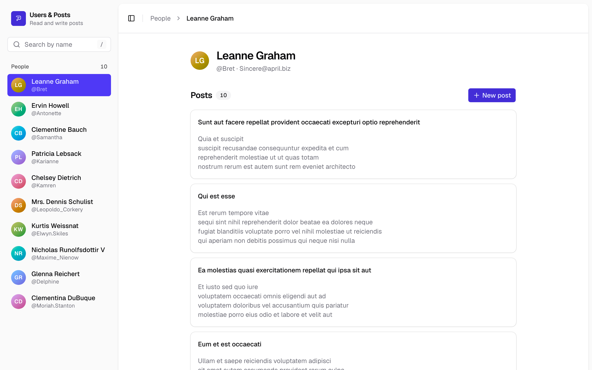

# Users & Posts

A small React and TypeScript app built on the [JSONPlaceholder](https://jsonplaceholder.typicode.com) API. A sidebar lists users and lets you search them by name. Selecting a user shows their posts and lets you write a new one through a validated form. The API doesn't save anything, so new posts are kept on the client and shown at the top of the list. Loading, empty and error states are handled for every request, and failed requests can be retried.



## Requirements

- Node.js 20.9 or later
- pnpm 11 (the version is pinned in `package.json`, so `corepack enable` picks it up)

## Running it

```bash
pnpm install
pnpm dev        # http://localhost:3000
pnpm test       # Jest and Testing Library
pnpm build      # production build, then `pnpm start` to serve it
```

`pnpm lint` and `pnpm typecheck` are also available.

## Project structure

```text
src/
  app/
    layout.tsx           root layout, providers and toaster
    providers.tsx        TanStack Query client
    users/
      layout.tsx         sidebar shell, prefetches the users list
      page.tsx           "Select a user" empty state
      error.tsx          users list failed, with retry
      [userId]/          posts page with loading, error and not-found states
  components/
    app-sidebar.tsx      search box and users menu
    posts/               user header, post list and new post form
    ui/                  shadcn/ui components
  hooks/                 query and mutation hooks
  lib/                   API client, types, query keys, zod schema, helpers
  test/                  MSW handlers, fixtures and a render helper
```

## Decisions

| Area         | Choice                                         | Why                                                                                                                                                                                                      |
| ------------ | ---------------------------------------------- | -------------------------------------------------------------------------------------------------------------------------------------------------------------------------------------------------------- |
| Framework    | Next.js 16 App Router, React 19, TS strict     | Nested layouts give the list and detail shell for free. `loading.tsx` and `error.tsx` cover each route segment. Prefetching on the server avoids a client waterfall on first load.                       |
| Server state | TanStack Query v5                              | Server prefetch with `HydrationBoundary`, then client caching and mutations.                                                                                                                             |
| Forms        | TanStack Form with a zod schema                | Stays in the TanStack ecosystem. The schema is reusable and easy to unit test.                                                                                                                           |
| UI           | shadcn/ui on Tailwind v4                       | The shadcn sidebar is the app shell and turns into a sheet on mobile with no extra work.                                                                                                                 |
| Search       | Server-side with `GET /users?name_like=<term>` | Case-insensitive on the API. The input is debounced by 300 ms and the term lives in the URL as `?q=`, so it survives reloads and navigation.                                                             |
| Tests        | Jest, React Testing Library, MSW v2            | `next/jest` with the `jest-fixed-jsdom` environment, since MSW v2 needs fetch and stream globals that plain jsdom lacks. Logic lives in client components, hooks and pure functions so it can be tested. |

Four things that weren't obvious at first:

1. **`POST /posts` always returns `id: 101`.** Two new posts would share a React key, so each one gets a client-side id from `crypto.randomUUID()`.
2. **New posts are stored apart from fetched ones.** Writing them into `['posts', userId]` means any refetch, or fresh server data when you come back to the user, wipes them out. They live under a client-only key, `['created-posts', userId]`, that is never fetched, and the list renders `[...created, ...fetched]`.
3. **Layouts don't receive `searchParams`.** The sidebar lives in a layout, so it reads `?q` with `useSearchParams()` inside a `<Suspense>` boundary.
4. **The search term is kept when you click a user,** so the filtered list stays the same while you browse.

## What I'd do with more time

- Optimistic updates with rollback when creating a post.
- Pagination or infinite scroll for posts.
- Editing and deleting posts.
- End-to-end tests with Playwright.
- Keep created posts across reloads with `localStorage`.
- An accessibility audit with axe.
- CI on GitHub Actions running lint, typecheck and tests.
- Deploy to Vercel.

## Time spent

About 2.5 hours.

## AI usage

I used Claude to help with the more tedious parts of the work: writing the plan, drafting pull requests and writing tests. I reviewed and tested all the code it produced before committing it.
